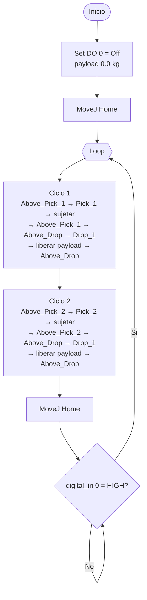

# Pick and Place en UR5 — PolyScope sobre Docker

Rutina de Pick and Place para un brazo Universal Robots UR5, desarrollada,
ejecutada y verificada sobre el simulador oficial URSim CB3 (PolyScope
3.15.8.106339) dentro de un contenedor Docker, y exportada al equipo local.

## Resumen de la práctica

El programa recorre dos puntos de recogida distintos y deja ambas piezas en un
único punto de entrega. Cada recogida y cada entrega se aproximan desde un
waypoint intermedio situado por encima del punto de trabajo, de modo que los
tramos de contacto son verticales y predecibles. El efector final se controla
con la salida digital 0 y la carga útil se declara al sujetar y se libera al
soltar. Al terminar los dos ciclos el programa queda a la espera de la
confirmación del operador mediante la entrada digital 0 en estado alto, y
entonces repite el bucle.

## Requisitos de la guía y cómo se cumplen

| Requisito | Implementación | Comprobado en |
|---|---|---|
| Al menos 2 puntos de recogida | `Pick_1` y `Pick_2` | traza de ejecución |
| Activar el efector final en cada recogida | `Set DO[0]=On` + pausa de 0.5 s | traza de ejecución |
| Dos puntos intermedios por trayectoria | `Above_Pick_n` sobre la recogida y `Above_Drop` sobre la entrega | árbol del programa |
| Pausas en los puntos intermedios | `Wait: 0.3` tras cada waypoint intermedio | árbol del programa |
| Liberar la carga útil en el punto de llegada | `Set DO[0]=Off` con `payload = 0.0 kg` en `Drop_1` | `set_payload(0.0)` en el script generado |
| Esperar confirmación por entrada digital | `Wait DI[0]=HI` al cerrar los dos ciclos | captura y ejecución |
| Reejecución del programa | nodo `Loop` infinito que reinicia tras la confirmación | captura del bucle reiniciado |

## Estructura del repositorio

```
ur5_pick_place/
├── README.md
├── programs/
│   ├── pick_and_place.urp                 programa PolyScope (guardado por PolyScope)
│   ├── pick_and_place.txt                 árbol del programa, generado por PolyScope
│   ├── pick_and_place_polyscope.script    URScript que genera PolyScope al ejecutar
│   ├── pick_and_place.urp.xml             el .urp descomprimido, para revisión
│   ├── pick_and_place.script              URScript equivalente, comentado
│   ├── default.installation               instalación a la que apunta el programa
│   └── default.variables
├── scripts/
│   ├── ursim_up.sh             levanta el contenedor URSim CB3 (UR5)
│   ├── importar_urp.sh         instala el programa dentro del contenedor
│   ├── exportar_urp.sh         copia los programas del contenedor al host
│   ├── encender_robot.py       power on y brake release por Dashboard Server
│   ├── calcular_cinematica.py  cinemática inversa pedida al propio controlador
│   ├── generar_urp.py          genera el .urp desde las coordenadas
│   ├── monitorizar.py          traza waypoints y E/S por la interfaz de tiempo real
│   └── forzar_entrada.py       fuerza digital_in[0] en el robot simulado
├── docs/
│   ├── waypoints.md            tabla de coordenadas y criterio de trayectorias
│   ├── diagrama_flujo.md       diagrama de flujo de la rutina
│   └── formato_urp.md          formato interno del fichero .urp
└── evidencias/
    ├── traza_urp.log           ejecución real del .urp
    ├── traza_script.log        ejecución real del .script
    └── capturas/               pantallas de PolyScope
```

## Entorno de simulación

Imagen oficial `universalrobots/ursim_cb3`, que corresponde a la generación CB3
y a PolyScope 3.x, la que equipa al UR5 (el UR5e usa `ursim_e-series`).

```bash
bash scripts/ursim_up.sh
```

El contenedor publica PolyScope por VNC en `http://localhost:6080/vnc.html`, el
Dashboard Server en el puerto 29999, las interfaces primaria y secundaria en
30001 y 30002, la interfaz de tiempo real en 30003 y RTDE en 30004. Dentro del
contenedor los programas viven en `/ursim/programs`.

Encendido y liberación de frenos sin tocar la interfaz gráfica:

```bash
python3 scripts/encender_robot.py
```

## Exportación de los programas desde Docker al equipo local

Comando directo, sin pasos intermedios, para traer todos los ficheros del
programa desde el contenedor:

```bash
docker cp ursim_ur5:/ursim/programs/. ./programs/
```

Para un único archivo:

```bash
docker cp ursim_ur5:/ursim/programs/pick_and_place.urp ./pick_and_place.urp
```

El sentido inverso, para instalar el programa dentro del simulador:

```bash
docker cp ./programs/pick_and_place.urp ursim_ur5:/ursim/programs/pick_and_place.urp
```

Ambos sentidos están envueltos en `scripts/exportar_urp.sh` e
`scripts/importar_urp.sh`. Al guardar el programa, PolyScope escribe junto al
`.urp` un `.txt` con el árbol y un `.script` con el URScript generado; los tres
se exportan con el mismo `docker cp`.

## Descripción técnica de las trayectorias

Marco de referencia: base del robot, metros y vector de rotación en radianes.
La orientación es común a todos los puntos, `(0, 3.1416, 0)`, que deja el eje Z
de la herramienta apuntando hacia abajo.

| Waypoint | X | Y | Z | Papel |
|---|---|---|---|---|
| Home | 0.400 | 0.000 | 0.350 | Reposo e inicio de ciclo |
| Above_Pick_1 | 0.500 | -0.200 | 0.250 | Intermedio sobre la primera recogida |
| Pick_1 | 0.500 | -0.200 | 0.050 | Primera recogida |
| Above_Pick_2 | 0.500 | 0.200 | 0.250 | Intermedio sobre la segunda recogida |
| Pick_2 | 0.500 | 0.200 | 0.050 | Segunda recogida |
| Above_Drop | 0.300 | 0.350 | 0.250 | Intermedio sobre la entrega |
| Drop_1 | 0.300 | 0.350 | 0.060 | Entrega común a los dos ciclos |

Criterio de movimiento:

- `MoveJ` para los desplazamientos largos entre zonas (Home, `Above_Pick_n`,
  `Above_Drop`): interpolación articular, más rápida y sin riesgo de
  singularidad en el camino. Velocidad 60 °/s, aceleración 80 °/s²
  (1.0472 rad/s y 1.3963 rad/s², los valores por defecto del UR5).
- `MoveL` para los tramos verticales de 0.19 m a 0.20 m entre cada punto
  intermedio y su punto de trabajo: garantiza descenso y ascenso rectilíneos
  sobre la pieza. Velocidad 250 mm/s, aceleración 500 mm/s².

La distancia radial máxima utilizada es 0.539 m, holgada frente al alcance
nominal de 0.850 m del UR5, y la altura mínima es 0.050 m sobre la base.

Cada waypoint del `.urp` guarda la pose cartesiana y la solución articular. Las
soluciones articulares no se eligieron a mano: se pidieron al propio
controlador con `get_inverse_kin()`, encadenando cada punto con el anterior
como semilla (`scripts/calcular_cinematica.py`), de modo que toda la rutina usa
la misma configuración de brazo y no hay reconfiguraciones bruscas entre
puntos.

## Señales y carga útil

- `digital_out[0] = HIGH` cierra el efector en `Pick_1` y `Pick_2`. En el mismo
  nodo se declara `payload = 1.0 kg`, y a continuación se espera 0.5 s para dar
  tiempo real de actuación antes de mover el brazo.
- `digital_out[0] = LOW` abre el efector en `Drop_1`, con `payload = 0.0 kg` en
  el mismo nodo: la carga útil queda liberada exactamente en el punto de
  llegada. Después, la pausa de 0.5 s.
- `digital_in[0]` es la confirmación del operador. Al cerrar los dos ciclos el
  programa se detiene en `Wait DI[0]=HI` hasta que la señal pase a alto, y
  entonces el `Loop` vuelve a empezar.

En el URScript que genera PolyScope esto se traduce en:

```
set_standard_digital_out(0, True)
set_payload(1.0)
...
set_standard_digital_out(0, False)
set_payload(0.0)
...
while (get_standard_digital_in(0) == False):
  sync()
end
```

## Código fuente

Árbol del programa tal y como lo escribe PolyScope
([`programs/pick_and_place.txt`](programs/pick_and_place.txt)):

```
 Program
   Robot Program
     Set DO[0]=Off
     MoveJ
       Home
     Loop
       MoveJ
         Above_Pick_1
       Wait: 0.3
       MoveL
         Pick_1
       Set DO[0]=On
       Wait: 0.5
       MoveL
         Above_Pick_1_ret
       MoveJ
         Above_Drop_c1
       Wait: 0.3
       MoveL
         Drop_1_c1
       Set DO[0]=Off
       Wait: 0.5
       MoveL
         Above_Drop_c1_ret
       MoveJ
         Above_Pick_2
       Wait: 0.3
       MoveL
         Pick_2
       Set DO[0]=On
       Wait: 0.5
       MoveL
         Above_Pick_2_ret
       MoveJ
         Above_Drop_c2
       Wait: 0.3
       MoveL
         Drop_1_c2
       Set DO[0]=Off
       Wait: 0.5
       MoveL
         Above_Drop_c2_ret
       MoveJ
         Home_fin
       Wait DI[0]=HI
```

Versión en URScript, legible y comentada
([`programs/pick_and_place.script`](programs/pick_and_place.script)):

```
def pick_and_place():
  global Home         = p[0.400,  0.000, 0.350, 0.0, 3.1416, 0.0]
  global Above_Pick_1 = p[0.500, -0.200, 0.250, 0.0, 3.1416, 0.0]
  global Pick_1       = p[0.500, -0.200, 0.050, 0.0, 3.1416, 0.0]
  global Above_Pick_2 = p[0.500,  0.200, 0.250, 0.0, 3.1416, 0.0]
  global Pick_2       = p[0.500,  0.200, 0.050, 0.0, 3.1416, 0.0]
  global Above_Drop   = p[0.300,  0.350, 0.250, 0.0, 3.1416, 0.0]
  global Drop_1       = p[0.300,  0.350, 0.060, 0.0, 3.1416, 0.0]

  def cerrar_garra():
    set_standard_digital_out(0, True)
    set_payload(1.0)
    sleep(0.5)
  end

  def abrir_garra():
    set_standard_digital_out(0, False)
    set_payload(0.0)
    sleep(0.5)
  end

  def ciclo(above_pick, pick):
    movej(above_pick, a=1.3963, v=1.0472)
    sleep(0.3)
    movel(pick,       a=0.5,    v=0.25)
    cerrar_garra()
    movel(above_pick, a=0.5,    v=0.25)
    movej(Above_Drop, a=1.3963, v=1.0472)
    sleep(0.3)
    movel(Drop_1,     a=0.5,    v=0.25)
    abrir_garra()
    movel(Above_Drop, a=0.5,    v=0.25)
  end

  set_standard_digital_out(0, False)
  set_payload(0.0)
  movej(Home, a=1.3963, v=1.0472)

  while (True):
    ciclo(Above_Pick_1, Pick_1)
    ciclo(Above_Pick_2, Pick_2)
    movej(Home, a=1.3963, v=1.0472)
    while (get_standard_digital_in(0) == False):
      sync()
    end
  end
end
```

## Diagrama de flujo



El detalle paso a paso está en [`docs/diagrama_flujo.md`](docs/diagrama_flujo.md).

## Carga y ejecución en PolyScope

1. Levantar el simulador: `bash scripts/ursim_up.sh`.
2. Abrir `http://localhost:6080/vnc.html` y esperar a PolyScope.
3. Instalar el programa: `bash scripts/importar_urp.sh`.
4. En PolyScope, *File > Load Program > pick_and_place.urp*, o por el Dashboard
   Server: `load pick_and_place.urp` en el puerto 29999.
5. Encender el robot y liberar frenos (`python3 scripts/encender_robot.py` o el
   botón de encendido de PolyScope).
6. Pulsar *Play*. Como el robot no está en el primer waypoint, PolyScope abre la
   pantalla *Move Robot into Position*: mantener pulsado *Auto* hasta que el
   brazo llegue a `Home` y aceptar. El programa arranca a continuación.
7. En la pestaña *I/O* se observa `digital_out[0]` conmutando en cada recogida y
   entrega.
8. Al terminar los dos ciclos el programa se detiene en `Wait DI[0]=HI`. Con el
   robot en modo *Simulation*, basta pulsar la entrada digital 0 en la pestaña
   *I/O* para que el bucle se repita.

Si el robot ya está en `Home`, el paso 6 se puede hacer entero desde el
Dashboard Server, sin interfaz gráfica:

```bash
printf 'load pick_and_place.urp\nplay\n' | nc localhost 29999
```

## Verificación realizada

Todo lo que sigue se comprobó sobre el UR5 simulado, no sobre el papel.

El programa cargado en PolyScope y ejecutado, leyendo la interfaz de tiempo real
del controlador (`scripts/monitorizar.py`, salida en
[`evidencias/traza_urp.log`](evidencias/traza_urp.log)):

```
   0.18 s  digital_out[0] = LOW
   0.18 s  digital_in[0]  = LOW
   0.18 s  waypoint Home
   3.39 s  waypoint Above_Pick_1
   5.11 s  waypoint Pick_1
   5.24 s  digital_out[0] = HIGH
   7.05 s  waypoint Above_Pick_1
   9.16 s  waypoint Above_Drop
  10.84 s  waypoint Drop_1
  10.97 s  digital_out[0] = LOW
  12.73 s  waypoint Above_Drop
  14.03 s  waypoint Above_Pick_2
  15.75 s  waypoint Pick_2
  15.89 s  digital_out[0] = HIGH
  17.69 s  waypoint Above_Pick_2
  19.00 s  waypoint Above_Drop
  20.67 s  waypoint Drop_1
  20.80 s  digital_out[0] = LOW
  22.56 s  waypoint Above_Drop
  24.20 s  waypoint Home
```

La secuencia sigue exactamente el orden previsto: la salida sube en cada punto
de recogida y baja en el punto de entrega, y los dos ciclos pasan por sus
waypoints intermedios. Esta traza se tomo sobre un contenedor recien creado,
con el programa instalado unicamente mediante `docker cp` y cargado por el
Dashboard Server, de modo que comprueba los ficheros que se entregan. Tras el último `Home` el robot deja de moverse: el
programa queda detenido en `Wait DI[0]=HI`
([captura](evidencias/capturas/espera_entrada_digital.png)). Al poner
`digital_in[0]` en alto desde la pestaña *I/O*
([captura](evidencias/capturas/io_entrada_alta.png)) el bucle vuelve a empezar
([captura](evidencias/capturas/bucle_reiniciado.png)).

La versión en URScript se envió por la interfaz secundaria (puerto 30002) y
produce la misma secuencia
([`evidencias/traza_script.log`](evidencias/traza_script.log)).

## Nota sobre el formato .urp

El `.urp` no es texto plano: es un XML serializado con XStream y comprimido con
gzip. Se puede inspeccionar con `zcat pick_and_place.urp`, y en este repositorio
se incluye ya descomprimido en `programs/pick_and_place.urp.xml`. El fichero que
se entrega lo escribió PolyScope al guardar el programa, de modo que es un
`.urp` nativo y no una reconstrucción. Los detalles del formato están en
[`docs/formato_urp.md`](docs/formato_urp.md).
